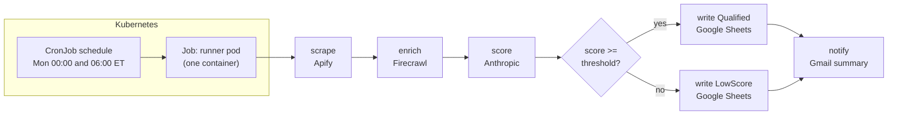

# lead-engine-k8s

> A real weekly lead-gen pipeline, packaged as a container and run on a schedule by Kubernetes, with a zero-spend dry-run so anyone can try it.

[](LICENSE)
[](https://github.com/JessAutomating/lead-engine-k8s/actions/workflows/ci.yml)
[](k8s/)
[](Dockerfile)
[](package.json)
[](https://www.linkedin.com/in/jessegjolly)

A weekly lead-generation pipeline (scrape, enrich, score, write, notify), packaged
as a container and scheduled with two Kubernetes CronJobs. It shows how to take a
finite, time-triggered batch job and run it on Kubernetes the way you would run any
scheduled workload.

New to Kubernetes? A CronJob is just a scheduled task: "run this every Monday at
12am, then exit." Kubernetes starts the container on schedule, retries it if it
fails, caps its CPU and memory, and keeps it isolated, which is exactly what a
recurring batch job like this one needs.

This is a sanitized portfolio version of a real automation: the code is fully here
and runnable, but the API keys, spreadsheet IDs, targeting lists, and client
identities are not. See [`NOTES.md`](NOTES.md) for the sanitized stage map.

## Architecture



## What this demonstrates

- Modeling a recurring batch job as a Kubernetes `CronJob` (the right primitive
  for "run this on a schedule, then exit").
- A clean split between code, configuration (`ConfigMap`), and secrets (`Secret`).
- A container that defaults to a safe, offline `--dry-run` so it can be tested
  end to end with zero API spend and zero real data.
- Production-shaped manifests: `concurrencyPolicy: Forbid`, `backoffLimit`,
  resource requests and limits, timezone-aware schedules, non-root and
  read-only-root-filesystem hardening.

## The pipeline

Five stages, run once per market segment, mirroring the source automation:

1. **scrape** (Apify): find candidate businesses for a segment.
2. **enrich** (Firecrawl): crawl each website for an audit.
3. **score** (Anthropic): rank fit, extract outreach fields as JSON.
4. **write** (Google Sheets): append qualified vs low-score rows.
5. **notify** (Gmail): send a run summary to the operator.

Branching matches the original: businesses with no website are flagged (still a
strong signal), invalid scores are dropped, and a per-segment threshold splits
leads into a qualified tab and a low-score tab.

## Origin

The pattern comes from two scheduled automations built in n8n that run the same
node graph on two weekly schedules. This repo reproduces the STRUCTURE only:

| Region     | Schedule        | CronJob                  |
| ---------- | --------------- | ------------------------ |
| region-one | Monday 12:00 am | `0 0 * * 1`              |
| region-two | Monday 6:00 am  | `0 6 * * 1`              |

Both schedules use `timeZone: America/New_York`.

## Quickstart (dry-run, no secrets)

`--dry-run` runs the whole pipeline against local fixtures. It makes zero network
calls and needs no credentials.

With Node 22 (the version the Docker image and CI use):

```sh
node src/index.js --dry-run
npm test
```

With Docker:

```sh
docker build -t lead-engine-k8s:0.1.0 .
docker run --rm lead-engine-k8s:0.1.0 --dry-run
```

Expected: a JSON run summary plus a rendered summary-email preview. The bare
`docker run lead-engine-k8s:0.1.0` (no args) also defaults to `--dry-run`.

## Run it on Kubernetes

Tested on Docker Desktop Kubernetes (context `docker-desktop`). Full command list
is in [`k8s/README.md`](k8s/README.md). Short version:

```sh
kubectl apply -f k8s/00-namespace.yaml
kubectl apply -f k8s/10-configmap.yaml
kubectl apply -f k8s/20-cronjob-region-one.yaml
kubectl apply -f k8s/21-cronjob-region-two.yaml

# Trigger a run now instead of waiting for Monday:
kubectl create job --from=cronjob/lead-engine-region-one test-run -n lead-engine
kubectl wait --for=condition=complete job/test-run -n lead-engine --timeout=120s
kubectl logs job/test-run -n lead-engine
```

The committed CronJobs ship in `--dry-run`, so applying them to any cluster is
safe and requires no secrets.

## Configuration and credentials

Non-secret settings live in the config file / `ConfigMap`. Secrets live only in
the environment / Kubernetes `Secret` and are never written to disk by the runner.

| Where                | What                                                        |
| -------------------- | ----------------------------------------------------------- |
| `config.example.json`| region label, segments, scoring model, tabs, limits         |
| `ConfigMap`          | placeholder sheet id, notify addresses, per-region configs  |
| `.env` / `Secret`    | `APIFY_TOKEN`, `FIRECRAWL_API_KEY`, `ANTHROPIC_API_KEY`, `GOOGLE_ACCESS_TOKEN` |

### Wiring real credentials (never committed)

1. Copy `.env.example` to `.env` and fill in real values. `.env` is gitignored.
2. Create the Kubernetes Secret from that `.env`:

   ```sh
   ./scripts/create-secret.ps1   # Windows
   ./scripts/create-secret.sh    # Linux / macOS
   ```

3. Remove `"--dry-run"` from the `args` in both CronJob manifests and re-apply.
4. Set your real `GOOGLE_SHEET_ID`, notify addresses, and segment lists in
   `k8s/10-configmap.yaml`, then re-apply.

In real mode the runner validates that every required credential is present and
fails loudly (non-zero exit, which marks the Kubernetes Job as failed) if any is
missing.

## Tech

| Layer             | Choice                                          | Why                                       |
| ----------------- | ----------------------------------------------- | ----------------------------------------- |
| Runtime           | Node.js 22                                      | modern, built-in `fetch` and test runner  |
| Dependencies      | none (Node built-ins only)                      | tiny image, no supply chain to audit      |
| Container         | Docker, `node:22-alpine`, non-root              | small and hardened                        |
| Orchestration     | Kubernetes `CronJob` (`batch/v1`)               | the primitive for scheduled batch jobs    |
| Config            | `ConfigMap` plus JSON files                     | non-secret settings, per region           |
| Secrets           | Kubernetes `Secret` from a gitignored `.env`    | keys never touch git or the image         |
| External services | Apify, Firecrawl, Anthropic, Google Sheets, Gmail | the five pipeline stages                |
| Tests and CI      | `node:test` plus GitHub Actions                 | dry-run suite runs on every push          |

## Security and sanitization

- `.gitignore` excludes `.env`, `.env.*` (except `.env.example`), generated secret
  manifests, and key files.
- The logger redacts known secret values from every log line.
- No real keys, spreadsheet IDs, targeting lists, geography, or client identities
  are present. The scoring prompt is vendor neutral.

## Status

- Dry-run pipeline: working, covered by CI (`node:test`).
- Docker image: builds, runs as a non-root user, defaults to `--dry-run`.
- Kubernetes: verified on Docker Desktop, both CronJobs apply and complete a manual
  run in-cluster.
- Live mode: ready once real credentials are wired via a gitignored `.env` and the
  `--dry-run` arg is removed.
- Sanitization: CLEAN (no real keys, sheet IDs, geography, verticals, or identity).

## Project layout

```
src/                 runner: CLI, config, logger, http, pipeline, stages/
fixtures/            local mock data for --dry-run
test/                node:test dry-run end-to-end test
k8s/                 namespace, configmap, two CronJobs, secret template, commands
scripts/             apply and create-secret helpers (PowerShell + bash)
.github/workflows/   CI: npm test on push and pull_request
Dockerfile           non-root Alpine image, defaults to --dry-run
NOTES.md             sanitized stage map from the study phase
```

## License

MIT, see [LICENSE](LICENSE).

---

Built by [Jesse Jolly](https://jessejolly.com) · [LinkedIn](https://www.linkedin.com/in/jessegjolly)
